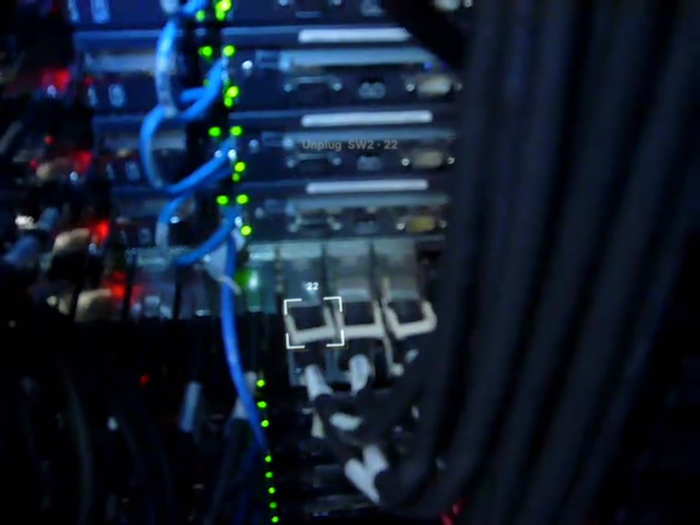

# AR display for data center cabling, on real first-person footage

A simulation of what a technician would see through an optical see-through AR headset while working on cables in a data center. The world is real: first-person footage of a technician removing InfiniBand cables from a live cluster rack, filmed from the worker's head. The display is simulated on top of it as light from a waveguide. It is tracked to the rack so its marks stay on the port, cut off at the display's field of view, and carries the optics' small flaws.

The UI is deliberately sparse. The technician's attention belongs on the port, the latch and the label, not on the headset. Everything on screen has to earn its place.

`python3 run.py render scenes/ib-decabling.json` produces `out/ib-decabling.mp4`: 28.6 s, 1440 × 1080, with the source's audio. The video is not committed; see [Footage](#footage) for why and how to get the clip.



## The scene: decommissioning rack C14's InfiniBand

The work order is a decabling job. The technician has already done step 1 when the clip starts. The HUD follows what the hands do in the footage, and each confirmation fires on the frame where the connector visibly comes out.

| Cut time | HUD | In the footage |
|---|---|---|
| 0.2 s | `Unplug  n07 · P1`, brackets and `P1` on the node's adapter port | the gloved hand reaches for the leftmost port of a node |
| 3.3 s | the brackets turn green and close on the port, with a small check | the first frames where the port is clearly empty |
| 5.5 s | `Unplug  SW2 · 22` | the hand leaves the node row; the head turns down toward the switch, which is not in view yet |
| 8.25 s | brackets converge on switch port 22 | the switch's three InfiniBand connectors come into view |
| 20.25 s | verified on 22 | the left connector comes out |
| 21.0 s | `Unplug  SW2 · 23`, brackets on 23 | |
| 21.8 s | verified on 23 | the middle connector comes out |
| 22.5 s | `Unplug  SW2 · 24`, brackets on 24 | |
| 26.25 s | verified on 24 | the right connector comes out |
| 26.9 s | `✓  C14 IB clear`, gone by 28.4 s | the head swings away |

During the fast pan from the nodes to the switch (about 6.8–7.7 s), the frames are too blurred to track. The world-locked marks fade out, as a headset hides content it has lost track of, and the instruction line stays. Dropouts of up to 4 frames are bridged instead, as a headset's IMU carries the pose through a short visual loss.

The video went through an independent frame-by-frame review with three lenses: optical realism, UI minimalism, and registration and timing against the hands. Its findings led to these changes:

- the visor veil now scales with the scene, because it had been fogging the blacks
- the HUD now goes through the source camera's pixel grid and chroma, because it had been sharper than the footage
- the HUD now gets full-shutter motion blur
- a purer confirmation green replaces the olive one
- the instruction line moved from the glove's path to the top band
- step changes now swap the line in sequence rather than cross-fading
- a confirmation is now cleared as soon as the next target appears
- the step counter and the "Removed" note were dropped
- three event times were corrected
- port 24 got its own reference frame, to remove a 15 px drift

## The HUD

At most four things are ever on screen, and usually just the brackets and their tag:

| Element | Locked to | What it shows | When |
|---|---|---|---|
| Target brackets | the rack | four open corner brackets just outside the one port to use, never filled, so the port, latch and printed label stay visible | from the moment the panel is in view until the connection is verified |
| Port tag | the rack | the short ID exactly as printed on the panel (`24`), above the brackets, never over the label strip | with the brackets |
| Instruction | the display, in the top band of the field (~11° above centre), out of the hands' reach path | one verb and the identifiers in the site's label format: `Unplug  SW2 · 22` | each step change. It steps aside (to 15%) once its target has been locked in view for 2.5 s, since the brackets then say the same thing, and returns if the target leaves view. It drops to 40% as soon as the step is verified. The old string fades out before the new one fades in, so two strings never overlap |
| Edge chevron | the display edge | a single `>` toward the target | only while the target is outside the display's field of view |

Confirmation is the only animation. When the system has a real verification event (a cable seated or pulled at the right port, link up or down reported by the switch), the brackets turn green, close into an outline that tightens onto the port's own footprint, and get a small check. They hold for 0.6 s and fade. If the next target is the neighbouring port, the confirmation clears within 0.15 s as the next brackets arrive. The confirmation uses shape as well as colour, because a green dot next to a switch port reads as a link LED, and about 8% of men have a colour-vision deficiency. A step counter (`"step_counter": true`) and a note word on confirmations (`"note"`) are supported but left off.

Deliberately left out: step counters, step cards and panels, backplates, paragraphs, the full work-order text, the full TIA-606 string, labels on every port, port grids, more than one highlighted port, asset and DCIM overlays (device health, temperatures, alarms), cable-route lines drawn across the rack, minimaps, clocks, battery, notifications, 3D hands or connector models, pulsing or looping animation, a second accent colour, and anything in the hands' working area other than the brackets.

Colours: one pale cyan for everything, green only for "done". An additive display cannot draw dark, so there are no backgrounds. Strokes are 2.2–3 px (≥ 0.1°) and text is Inter SemiBold, because thin lines and light weights shimmer and break up on a waveguide.

The design follows the in-situ guidance literature: world-registered cues beat instruction panels on speed and errors (Tang et al., CHI 2003; Henderson & Feiner, TVCG 2011; Funk et al., UbiComp 2016), the edge chevron is the off-screen-target cue from the same work, and the one-target-at-a-time rule copies intelligent-patching hardware (AIM, ISO/IEC 18598), which lights one LED at the port to use.

## The display model

The headset modelled is a binocular diffractive-waveguide display of the HoloLens 2 / Orion class, with a 44° × 28° field of view by default.

- **Field of view.** The image exists only inside the display's field, which is much smaller than the camera's. Its edge is never drawn: content fades over the last ~1° and is cut there. With a phone or GoPro-linear camera, the display covers roughly the middle half of the frame.
- **Additive light.** The display can only add light. Black is transparent, and the world behind is never dimmed. The marks pop against black switch faces and wash out against a lit white cold aisle. The visor adds a faint veil in proportion to the light around (about 1% of the scene's mean, so nearly nothing in a dark rack) and tints the world very slightly.
- **Waveguide flaws.** Each is a few percent and fixed to the display, not the world:
  - colour drifts across the field in broad magenta, cyan and green lobes
  - the corners are about 30% dimmer than the centre
  - lateral colour puts red and blue a fraction of a pixel apart
  - a ghost image sits about 0.6° off at 3.5%
  - a tight glow and a wide, low halo (σ ≈ 1°) surround bright strokes
  - the gratings smear the overhead LED troffers into faint rainbow streaks inside the field
- **Focus.** The virtual image sits at about 2 m while the hands work at 0.5 m, so with the camera focused on the rack the HUD is slightly soft.
- **Registration.** World-locked marks are drawn from the tracked pose, minus a few milliseconds of uncorrected render-to-photon latency, plus sub-pixel tremor. They sit still when the head is still and trail slightly in quick turns, as on real headsets. Hands and cables do not hide the marks: a see-through display draws on top of everything, and that is part of what makes it look real.
- **The camera.** The HUD's light is resampled down to the source camera's pixel grid (`native_size`, 640 × 480 here) and back up the way the footage was, and its chroma is blurred as 4:2:0 recording would. That keeps it from being the sharpest thing in the frame. World-locked marks get the footage's full-shutter motion blur, with velocity taken as a central difference over the neighbouring frames. The camera's auto-exposure follows the scene: in a dim aisle it opens up and the HUD reads brighter, and panning onto a bright aisle dims it (about 0.4 s lag). The display's own ambient-light sensor works the other way and dims the display in the dark, so the scene uses a weak coupling (`exposure_k` 0.15) and `gain` 0.95 for this dark rack. That keeps the strokes reading as translucent light rather than white paint. World-locked marks get the same motion blur as the footage. Shot noise is added to the display's light, and a soft shoulder lets bright strokes clip toward white the way a sensor does.

## Pipeline

```
footage (yt-dlp) -> frames at the output size
  -> planar tracking per rack surface (track.py)
       SIFT on a reference frame inside the surface's outline; pyramidal LK frame to frame with a forward-backward
       check; MAGSAC homographies from reference->current point pairs; SIFT re-match every 6 frames against the
       reference (no drift); corners smoothed over +-2 frames; cached in cache/
  -> HUD state at t from the scene's timeline (scene.py), a pure function of time
  -> world layer (brackets, tag, confirmation) through the homography; head layer (instruction, chevron) (hud.py)
  -> optics and camera (optics.py) -> additive composite in linear light -> H.264 with the source audio
```

The tracker is checked against ground truth with `tools/synth_track_test.py`. It uses a textured plane filmed by a simulated head camera, with head sway, a fast glance away and back, motion blur, a hand-sized occluder sweeping across, noise and JPEG blocking. At 1080p the error on a grid of points over the plane is 0.54 px median and 1.0 px at the 95th percentile (about 0.03°), and no frame is lost.

## Run it

Needs Python 3 with `opencv-python-headless`, `numpy`, `pillow` and `yt-dlp`, and `ffmpeg` on the path. The Inter font is used if installed; DejaVu Sans otherwise.

```
cd docs/arhud-dc
python3 run.py fetch  scenes/<scene>.json            # source clip into footage/ (not committed)
python3 run.py frames scenes/<scene>.json --every 1  # frames with a pixel grid, for placing ports
python3 run.py stills scenes/<scene>.json 3.2 7.5 --compare
python3 run.py render scenes/<scene>.json            # -> out/<scene>.mp4
```

### Scene format

A scene is one cut of one source video. Coordinates are output-frame pixels on the plane's reference frame; times are seconds from the start of the cut.

```json
{
  "source":   {"url": "https://www.youtube.com/watch?v=...", "file": "footage/<id>.mp4", "t0": 12.0, "t1": 40.0},
  "display":  {"camera_hfov_deg": 70, "hfov_deg": 44, "vfov_deg": 28, "center": [0.5, 0.5]},
  "planes":   [{"name": "pp3", "ref_t": 2.0, "poly": [[x, y], [x, y], [x, y], [x, y]]}],
  "blocks":   [{"plane": "pp3", "prefix": "PP3-", "corners": [tl, tr, br, bl], "rows": 1, "cols": 24}],
  "ports":    {"SW2-17": {"plane": "sw2", "quad": [tl, tr, br, bl]}},
  "timeline": [{"t": 0.3, "step": "2/6", "text": "Connect  PP3 · 24"},
               {"t": 0.8, "target": "PP3-24", "label": "24"},
               {"t": 6.1, "done": "PP3-24"},
               {"t": 7.0, "step": "end", "text": "✓  C14 clear", "hold": 2.0}]
}
```

`planes` entries take `t_range` to track only part of the cut. `ports` entries can be read off any frame with `"at_t"`, and are carried back to the plane's reference frame through the tracking. `display` also takes the optics' parameters (`gain`, `tint`, `corner_falloff`, `ghost_deg`, `halo_deg`, `defocus_px`, `native_size`, `chroma_blur_px`, `shutter`, `flare`, `residual_latency_ms`, `tremor_px`, `exposure_ref`, `exposure_k`, `stroke_px`, `line_y`, `step_counter` and the font sizes); see `optics.py` and `render.py` for the defaults. `run.py trackviz` renders the tracked outlines and ports over the footage for checking.

## Footage

**"Infiniband cluster decabling"** by *phrenologist* on Flickr (http://www.flickr.com/videos/51035766041@N01/4366776083/), licensed CC BY-NC 2.0. It is 73 s at 640 × 480 and 29.97 fps, recorded in February 2010. The cut used is 9.0–37.6 s. The same author's part 2, "Infiniband Cluster decabling 2" (4367522800, same licence), is a usable second clip. The licence allows non-commercial use with attribution, so renders must credit the author and must not be used commercially.

`run.py fetch` downloads the file from Multimedia Commons (`multimedia-commons.s3.amazonaws.com`), the public S3 mirror of YFCC100M's 787,000 Creative Commons Flickr videos. The footage is not committed.

How it was found: the network of the environment this was built in blocks YouTube, Pexels, Pixabay, Vimeo, Wikimedia and the Internet Archive, but allows S3. The only searchable YFCC100M metadata on Multimedia Commons is a 65 GB SQLite file. `tools/yfcc_search.py` streams it in parallel byte ranges and never stores it. GNU grep finds pages mentioning data-center and cabling terms, and the script parses those b-tree pages, records and overflow chains in place, keeping video rows only. Each video's S3 key is the MD5 of its Flickr download URL, written as unpadded hex per byte. The full scan took about 40 minutes and found 39 videos. Two of them are real first-person cabling work, both by the same author.

The pipeline also takes YouTube sources (`"url"` instead of `"mp4"`, fetched with yt-dlp) if the environment allows `www.youtube.com` and `*.googlevideo.com`. Most first-person cabling footage there is under the standard YouTube licence, which does not allow redistributing renders.
