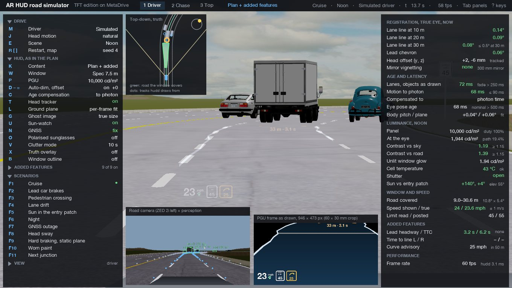

# AR HUD road simulator (TFT LCD edition, on MetaDrive)

A driving simulation of the HUD in `docs/ARHUD-PLAN-TFT-SPEC.md` on real procedurally generated roads with traffic. MetaDrive supplies the world: roads with lanes, curves, ramps, intersections and roundabouts, traffic, pedestrians, vehicle physics and the rendering. On top of it, the plan's software runs in miniature every frame: simulated sensors with the plan's error models, perception, egod, headtrackd, hudd with its drawing rules and age compensation, and controllerd. The result is shown the way the optics would show it, as light on the virtual-image plane in front of the driver. The app measures registration against the truth from the driver's true eye, live and against the plan's acceptance criteria.

It sits beside the Three.js simulator in `docs/arhud-sim` (which builds and explains the hardware) and reuses its rules and numbers. The numbers come from `docs/arhud-plan-tft-src/calc.py`, imported directly. hudd is a port of `arhud-sim/js/hud.js`. The traced window and mount positions come from `arhud-sim/js/geom.js`. It then adds what that simulator could not do: real roads and traffic, a ground plane that pitches with the body, scripted events, and nine features beyond the plan, each one switchable.



## Run it

Needs the MetaDrive environment described in `docs/arhud-sim/README.md` (`~/.venvs/arhud-metadrive`, MetaDrive from GitHub commit `fe54b03`, Python 3.11). On macOS it must run in a logged-in desktop session, because MetaDrive renders through an on-screen window.

```
cd docs/arhud-road
~/.venvs/arhud-metadrive/bin/python run.py
```

Useful options:

| Option | What it does |
|---|---|
| `--map SCrSXSOSCTSRS` | the road, as MetaDrive block letters (S straight, C curve, r on-ramp, R exit ramp, X intersection, T T-junction, O roundabout) or a block count |
| `--seed 3 --scenarios 20` | first map seed and how many seeds `[` `]` cycle through |
| `--traffic 0.12`, `--oncoming`, `--lanes 3` | traffic density, traffic in the other carriageway, lanes per side |
| `--env noon\|overcast\|dusk\|night` | starting scene |
| `--hud-window spec\|traced\|stage1` | the plan's 10.8° × 5.4° window at 7.5 m, the traced 8.7° × 4.6° at 8.56 m, or Stage 1's 16° × 8° combiner at 4.2 m |
| `--content plus\|plan` | the plan's content plus the added features, or the plan as written |
| `--scenario lead_brake` | start a scenario 3 s in |
| `--log run.csv` | per-frame numbers (every 6th frame) to CSV |
| `--shots tour\|scenes\|quick` | scripted screenshots: `tour` saves 16 across views and scenarios, `scenes` the wide view, dusk, overcast and night |
| `--bench` | replays one seeded drive under each condition and prints the registration table below |
| `--fast` | don't hold the simulation to real time |
| `--no-camera-inset` | skip the extra road-camera render (about 8 ms a frame) |

On this M4 Mac at 1360 × 765 it runs at about 50–60 fps with everything on. The simulation clock is fixed at 60 Hz (physics, hudd); the camera topics run at 30 Hz. If the machine falls behind, the simulation slows down rather than skipping frames, so latencies and ages always stay in simulated time.

## The screen

- **Driver view (1).** You sit at the driver's eye, 1.22 m up and 0.37 m left of the car's centreline, and see the road through the windshield. The HUD's virtual image floats over the road 7.5 m ahead (or wherever the selected window puts it). It is drawn as additive light in its own layer with no depth test: the light comes off the glass, so it lies over everything, including a car closer than 7.5 m. `Z` cycles the field of view: 60°, 35° (default) and 16°, the last filling the screen with the HUD window.
- **Chase (2) and top (3) views.** The car from outside with the virtual image as a card in space, its frustum from the eye, and the stretch of flat road the window covers (green: about 9 to 31 m with the spec window).
- **Left panel.** Every control, with its key. Click a row or press the key. Section titles fold.
- **Right panel.** Live numbers beside the plan's criteria: registration of the lane lines at 10, 20 and 30 m and of the lead chevron, measured from the true eye against the truth now. Also head offset and mirror vignetting; age per topic and motion-to-photon; body pitch against the ground-plane estimate; panel and eye luminance with contrast against sky and road, black level, cell temperature, shutter, and the sun against the entry patch; road covered; speed shown against true speed; the speed limit read against the one posted. Then the added features' state (headway, time to collision, time to line crossing, next junction, curve advisory) and the frame rate.
- **Insets.** The PGU frame exactly as hudd draws it (946 × 473 px, the 60 × 30 mm crop); the road camera (the ZED 2i's left lens, rendered from its mount high on the windshield) with what perception reported; and a top-down map of the truth, the tracks hudd draws from and the window's road coverage.
- `Tab` hides the panels, `?` lists the keys, `S` saves a screenshot to `screenshots/`, `Space` pauses, `Esc` quits and prints the registration summary.

## What runs each frame

```
MetaDrive physics (1/60 s)
  -> truth: route lane chain 160 m ahead, every painted boundary, traffic, pedestrians, signs   (truth.py)
  -> egod history: speed, yaw rate, body pitch                                                   (perception.py)
  -> every 2nd frame, a camera capture at 30 Hz: roadd/laned/detectd
       lane points = camera rays intersected with the ground-plane estimate (fit / static+IMU / static),
       lateral error 0.02 + 0.004 x m, confidence by range and paint, ZED field of view, occlusion,
       detection probability by class and range, stereo range error inside 35 m (0.25 px disparity),
       ground-plane range beyond, speed-limit sign reads
     queued until capture + camera + inference + publish (the latency budget) has passed
  -> headtrackd: the true head offset, 40 ms late, 3 mm noise; nominal eye after 500 ms
  -> hudd at draw time = now - (render + scan-out):
       newest published message, drawing rules (3 frames to appear, hysteresis, stale fade 250-600 ms,
       ribbon 3.7 m from one line, hazards after 3 detections, 400 ms persistence), age compensation
       p_now = Rz(-dpsi)(p_capture - [dx, dy]) from egod's noisy speed and yaw rate, to photon or draw time,
       tracks advanced by their own velocity, projection from the tracked eye onto the virtual plane
  -> controllerd: dimming curve from the ambient sensor, cell thermal model with derate and cut-off,
     sun-watch against the ray-traced entry patch, shutter
  -> optics: mirror-aperture vignetting for the true eye, the frame as light on the virtual plane,
     the ghost 3.1 mm away at 58%, the unlit window's glow, polarised sunglasses
  -> registration: drawn pixel -> direction from the true eye, against the true line or lead now
```

**How bright the HUD looks.** The app adds the image in linear light. A frame value c is emitted as luminance c^2.2 × L_eye. Relative to the scene, that is a fraction L_eye / L_adapt of the adapting background (the road), whose display level is known. The HUD layer is composited after MetaDrive's linear-to-display pass, so the framebuffer holds display values, and the shader adds exactly that luminance to a background at the road's level. So the contrast you see against the road is the plan's own number (1.39 for the design backlight at noon). The image is slightly overstated against the brighter sky. The scenes use the same luminances as the 3-D simulator: noon road 5,000 and sky 10,000 cd/m², overcast, dusk, and night with a headlit road at 1.5 cd/m².

## Scenarios

| Key | Scenario | What to watch |
|---|---|---|
| F1 | Cruise | defaults: noon, traffic, posted limits by block (55 straight, 45 curve, 35 junction, 25 roundabout) |
| F2 | Lead car brakes | a car pulls in 28 m ahead and brakes at 6.5 m/s² while the driver looks away for 1.4 s: chevron with gap and headway, then the collision warning |
| F3 | Pedestrian crossing | someone steps off the right kerb timed to reach the ego lane as the car arrives: hazard outline after 3 detections, the predicted path turning red |
| F4 | Lane drift | the driver drifts right without signalling: the right line glows when the time to crossing drops under 1 s |
| F5 | Sun in the entry patch | the sun is put behind the car at 51° up: sun-watch closes the shutter and the image disappears; with sun-watch off (U) the cell heats toward cut-off |
| F6 | Night | auto-dimming to the plan's 50 cd/m² ceiling: the window reads as a bright slab, 33 times a headlit road |
| F7 | GNSS outage | 12 s without a fix: the speed shows a dash, prediction stops, and the ribbon and chevron lag in curves |
| F8 | Head sway | ±75 mm side to side: 10 s with the tracker, then 10 s on the nominal eye |
| F9 | Hard braking, static plane | 7 m/s² stop with the ground plane fixed at its parked calibration: the nose dips 2.2° and far points slide; `L` back to the per-frame fit |
| F10 | Worn paint | 80 m of worn lines: confidence drops, lines fade by hysteresis, the ribbon goes one-sided and lighter |
| F11 | Next junction | jumps to 130 m before the next junction at least 150 m ahead: turn arrows and distance |

## Features beyond the plan (`K` toggles plan / plus; Shift+1…9 each)

Each one uses only hardware the plan already has: the road camera's lanes and tracks, egod's speed and yaw rate, GNSS against a map route, and the head tracker. None draws a path for the car. The plan excludes a drive path and lists lane-departure warnings and navigation arrows as stretch goals.

| | Feature | How it works |
|---|---|---|
| ⇧1 | Turn-by-turn arrows | chevrons every 5 m on the route lane up to 25 m past the start of the turn, from the map route with 0.25 m lateral and 0.8 m longitudinal map/GNSS error. A glyph and distance in feet, bottom right |
| ⇧2 | Lane-departure glow | time to line crossing from a line fit to the near ego-line points (front-wheel distance ÷ approach rate). Under 1 s, above 12 m/s and unsignalled (`,` `.` signal), the line glows amber |
| ⇧3 | Forward-collision warning | headway and time to collision from the lead track: amber chevron under 1 s headway, red pulsing chevron and a BRAKE bar under 2.6 s TTC |
| ⇧4 | 2-second gap marker | a bar across the ribbon at 2.45 m + 2 s × speed |
| ⇧5 | Curve-speed advisory | the slowest curve within 160 m on the route at 2.4 m/s² lateral, shown beside the speed limit when it is below the limit or the current speed |
| ⇧6 | Pedestrian path prediction | a dashed 3 s ground path for each tracked pedestrian or cyclist; red, with a pulsing outline, when it will be in the ego lane when the car gets there |
| ⇧7 | Speed-limit compliance | the speed turns amber above the limit + 3 mph, red above + 10 |
| ⇧8 | Eye-box guide | arrows at the window edge when the tracked eye is within 25% of the eye box's edge |
| ⇧9 | Lead occludes ground | ground graphics end at the lead's rear bumper, and nothing is drawn inside the projected box of a nearer tracked vehicle |


## Registration measured on the road

`run.py --bench --fast` replays the same seeded 24 s drive (map `SCrSXSOSCTSRS`, seed 3: straight, curve, on-ramp, traffic) once per condition. Traffic, sensor noise and head motion are deterministic for a seed, so the rows differ only in the condition. Residual is the angle between where hudd drew the element and where the true element is now, seen from the true eye. "Lane" is the ego right line at 30 m; "lead" is the chevron against the lead's true rear bumper. Run on 2026-10-22.

| Condition | Lane 30 m, median / 95th | Lead chevron, median / 95th | Plan's criterion |
|---|---|---|---|
| Baseline: compensation to photon time, tracker on | 0.04° / 0.14° | 0.08° / 0.24° | ≤ 0.5° static at 30 m |
| ±75 mm head sway, tracker on | 0.04° / 0.15° | 0.09° / 0.25° | ≤ 0.3° under head motion |
| Same sway, tracker off (nominal eye) | 0.08° / 0.29° | 0.31° / 0.49° | fails |
| Compensation to draw time (the plan's formula) | 0.04° / 0.14° | 0.07° / 0.23° | |
| No compensation | 0.04° / 0.17° | 0.09° / 0.46° | |
| GNSS outage (prediction off) | 0.04° / 0.17° | 0.09° / 0.46° | |
| Lead brakes at 6.5 m/s², compensated | 0.04° / 0.11° | 0.07° / 0.23° | |
| Lead brakes, no compensation | 0.05° / 0.16° | 0.09° / 0.78° | |
| Hard braking at 8 s, static plane | 0.06° / 0.19° | 0.11° / 0.30° | |
| Hard braking at 8 s, per-frame plane fit | 0.04° / 0.15° | 0.05° / 0.21° | |
| Traced window (8.56 m, 8.7° × 4.6°) | 0.04° / 0.13° | 0.07° / 0.21° | |

The lane at 10 m reads about 0.12° in every condition. That comes from the lane model's lateral noise (0.02 + 0.004 x m), not from the optics or the timing.

## What this simulation found

These are in addition to the 3-D simulator's list.

- **Latency hurts objects, not lane lines.** A lane point that arrives late has slid along its line, which is invisible, so the 30 m lane residual hardly changes without compensation (0.17° against 0.14° at the 95th percentile). Objects moving at a different speed from the car show it: with a braking lead, the chevron goes from 0.23° to 0.78°. The plan's worked example (2.9° at 10 m and 30 m/s) is for a fixed point, such as a stopped car, a pedestrian or a sign.
- **A GNSS outage costs exactly what switching compensation off costs** (0.46° on the lead), because the plan stops prediction without a fix. Dead reckoning from the F9R's IMU through short outages would keep most of it.
- **The head tracker is what keeps the lead chevron inside 0.3°.** A ±75 mm sway puts the lead at 0.49° with the nominal eye and 0.25° with the tracker. The near lane lines barely change, as the corrected parallax formula predicts: the error grows with distance beyond the image.
- **The ground plane matters under braking.** A 7 m/s² stop pitches the body 2.2° nose-down. With the parked calibration the lead chevron reaches 0.30° at the 95th percentile. The per-frame fit (modelled with 0.05° of fit noise) keeps it at 0.21°.
- **The translucent ribbon vanishes at noon.** With the design backlight (1,944 cd/m² at the eye), a fill at the 3-D simulator's 32% alpha emits about 60 cd/m² over a 5,000 cd/m² road: a contrast of 1.01 against the 1.15 threshold. The lines, the chevron and the text carry the daytime picture. To reach 1.15 against the road, a fill has to emit about 750 cd/m², 39% of full white. At night the same fill is too bright (the slab).
- **The 2-second gap bar is outside the window above 31 mph.** The spec window covers flat road only to 30.6 m, and 2.45 m + 2 s × v passes that at 14.1 m/s.
- **Turn arrows appear only in the last 30 m.** The window's road coverage, not the arrows, sets the warning distance; the distance glyph has to do the work before that.
- **The ribbon is wider than the window near the car,** as the 3-D simulator found: below about 19.5 m it fills the window edge to edge. On the road this reads as a slab over the whole lower half of the window, and occlusion by the lead is what gives it a visible far end.

## Files

```
run.py                 entry point, options, scripted tours
arhud_road/plan.py     numbers from calc.py and traced.json; frames and conventions
arhud_road/traced.json the traced window and mounts, written by tools/dump_traced.mjs from arhud-sim
arhud_road/world.py    MetaDrive environment, signs, pedestrians/cyclists, scene presets
arhud_road/truth.py    ground truth: route lane chain, painted boundaries, objects, next junction
arhud_road/frames.py   car frame (on the chassis, pitching with it), the virtual plane, projection
arhud_road/perception.py  sensors and perception with the plan's error models; egod; headtrackd
arhud_road/hudd.py     the renderer: drawing rules, compensation, projection, speed block, residuals
arhud_road/features.py the nine added features
arhud_road/controllerd.py dimming, thermal, sun-watch, shutter, luminance-to-display gain
arhud_road/optics.py   display regions, the HUD light shader, ghost, vignetting, cockpit, chase-view geometry
arhud_road/driver.py   the simulated driver (pure pursuit, IDM, limits, curves) and head motion
arhud_road/scenarios.py the eleven scenarios
arhud_road/ui.py       panels, insets, map, help, clicks
arhud_road/canvas.py   OpenCV/PIL drawing with Helvetica Neue
tools/dump_traced.mjs  regenerates traced.json (node tools/dump_traced.mjs)
shots/                 the screenshots in this README
```

## Simplifications

- Perception is ground truth passed through the plan's error models, not the networks. The road-camera inset is a real render from the ZED's mount, but it is not fed to a detector.
- MetaDrive roads are flat. Pitch comes only from the suspension, under acceleration, braking and bumps, so the RANSAC-against-static comparison covers body pitch, not grade.
- Night and dusk darken and tint the whole scene; there are no headlights. The HUD's light is added on top, so its brightness against the scene is right at the road's level.
- The sun is MetaDrive's directional light; the sun scenario sets it from the car's heading.
- The simulated driver reads ground truth. It stands in for a person watching the road, not for anything the plan builds.
- The cockpit is plain geometry: dash, binnacle, HUD dust cover, A-pillars, roof header, mirror, ZED 2i and hood. It shows at the 60° zoom; at 35° only the windshield is in view.
- MetaDrive instances one body model per vehicle class. The ego gets a private copy of its body so that hiding it in the driver view does not hide the same body on traffic cars.

## Possible next steps

- Publish the spec's topics (`lanes`, `objects`, `ego`, `eyePose`, `health`, `sunWatch`) over ZeroMQ + msgpack from `perception.py`, so the real `hud/` package's hudd can be developed against MetaDrive roads (pyzmq and msgpack are not yet in the venv).
- Replace the lane error model with a lane network on the rendered road-camera image, to test the plan's G1 gate in simulation.
